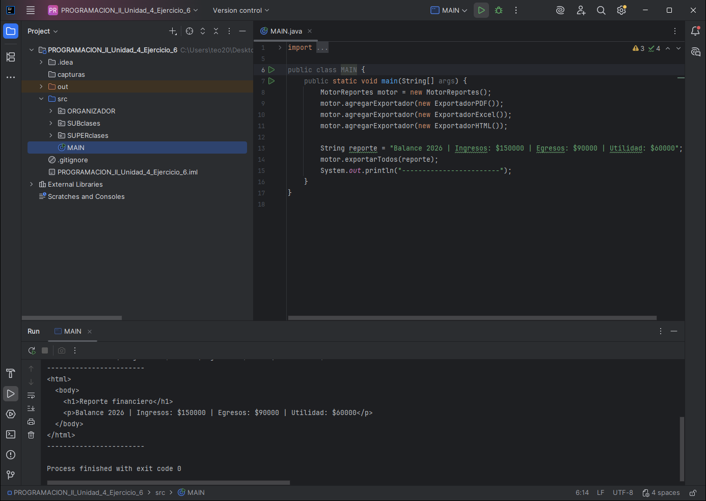

# PROGRAMACIÓN II — Unidad 4, Ejercicio 6: El Sistema de Exportación de Reportes Financieros

Trabajo práctico de Programación II. Este repositorio contiene la resolución en Java del ejercicio 6 de la Unidad 4.

## Consigna

#### Contexto

Los sistemas de gestión empresarial generan balances contables que deben exportarse a múltiples formatos digitales (PDF, planillas de cálculo Excel y documentos HTML). Gracias al polimorfismo, el motor de reportes genera la salida solicitada invocando un método genérico de exportación sin conocer los detalles de las librerías de formato subyacentes.

#### Consigna

Implementar una solución en Java donde el generador de reportes utilce polimorfismo para transformar y exportar estructuras de datos financieras a diferentes formatos de archivo.

#### Desarrollo requerido

- Definir una interfaz o clase abstracta Exportable con el método void exportar(String contenidoReporte).
- Crear clases concretas como ExportadorPDF, ExportadorExcel y ExportadorHTML que implementen el contrato con sus respectivas simulaciones de marcado y estilos.
- Diseñar la clase coordinadora MotorReportes que gestione una colección de objetos exportables y ejecute la conversión de manera masiva.
- En el método main, instanciar los distintos exportadores, procesar un reporte financiero base mediante polimorfismo y mostrar los resultados formateados por consola.

## Estructura del repositorio

```
PROGRAMACION_II_Unidad_4_Ejercicio_6/
├── README.md
├── capturas/
│   └── consola.png
└── src/
    ├── ORGANIZADOR/
    │   └── MotorReportes.java
    ├── SUBclases/
    │   ├── ExportadorExcel.java
    │   ├── ExportadorHTML.java
    │   └── ExportadorPDF.java
    ├── SUPERclases/
    │   └── Exportable.java
    └── MAIN.java   # clase con el método main
```

## Funcionamiento y lógica

El ejercicio aplica **polimorfismo con una interfaz** para exportar un reporte financiero a varios formatos. Está organizado en los paquetes `SUPERclases`, `SUBclases` y `ORGANIZADOR`.

### `SUPERclases.Exportable` (interfaz)

Define el método `void exportar(String contenidoReporte)`.

### `SUBclases`

Cada exportador implementa la interfaz y arma la salida con su propio formato:

- **`ExportadorPDF`:** cabecera `%PDF-1.4`, la página con el texto y el cierre `%%EOF`.
- **`ExportadorExcel`:** una hoja con el título en la celda A1 y el contenido en la B1.
- **`ExportadorHTML`:** una página HTML con un título `<h1>` y el contenido en un párrafo `<p>`.

### `ORGANIZADOR.MotorReportes`

Guarda una lista de exportadores (`List<Exportable>`).

- **`agregarExportador()`:** suma un exportador a la lista.
- **`exportarTodos(contenido)`:** recorre la lista y le pide a cada exportador que exporte el mismo contenido.

### `MAIN`

Agrega los tres exportadores al motor y exporta el reporte "Balance 2026 | Ingresos: $150000 | Egresos: $90000 | Utilidad: $60000". El mismo contenido sale en formato PDF, Excel y HTML.

## Ejecución

Captura de la consola de IntelliJ IDEA ejecutando el programa:



Salida obtenida:

```
------------------------
%PDF-1.4
[Página 1]
Texto: Balance 2026 | Ingresos: $150000 | Egresos: $90000 | Utilidad: $60000
%%EOF
------------------------
Hoja1
A1: Reporte financiero
B1: Balance 2026 | Ingresos: $150000 | Egresos: $90000 | Utilidad: $60000
------------------------
<html>
  <body>
    <h1>Reporte financiero</h1>
    <p>Balance 2026 | Ingresos: $150000 | Egresos: $90000 | Utilidad: $60000</p>
  </body>
</html>
------------------------
```
